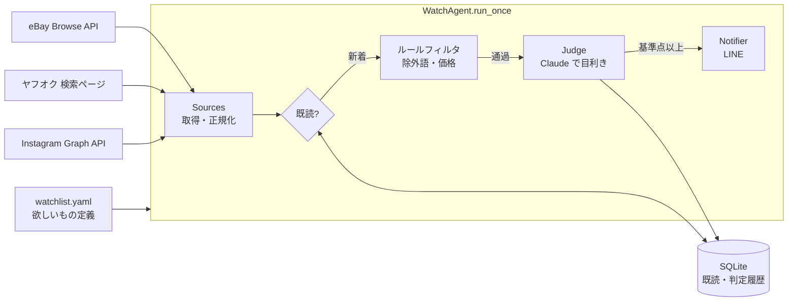

# vintage-watcher

ヴィンテージ古着の新着出品を定期的に巡回し、**Claude が「目利き」して、本当に欲しいものだけを LINE に通知する**エージェントです。

```
「リーバイス 501 66前期」で検索 → 50件ヒット
   ├─ 既読（前回までに見た）         … 45件  → スキップ
   ├─ ルールで除外（LVC・価格外など） …  2件  → スキップ
   └─ Claude が写真と説明文を見て判定 …  3件
         ├─ 92点「スモールe・シングルステッチ確認。W33で条件一致」 → LINE通知
         ├─ 55点「66後期の可能性が高い」                          → 記録のみ
         └─ 20点「現行品」                                         → 記録のみ
```

---

## 目次

1. [全体アーキテクチャ](#1-全体アーキテクチャ)
2. [各コンポーネントの解説](#2-各コンポーネントの解説)
3. [セットアップ](#3-セットアップ)
4. [使い方](#4-使い方)
5. [定期実行（GitHub Actions / 常駐）](#5-定期実行)
6. [コストの目安](#6-コストの目安)
7. [メルカリ・ラクマについて](#7-メルカリラクマについて)
8. [拡張のヒント](#8-拡張のヒント)

---

## 1. 全体アーキテクチャ



### 設計で大事にしたこと

| 方針 | 理由 |
|---|---|
| **ファネル構造**（安い処理 → 高い処理） | LLM 判定は1件ごとにお金と時間がかかる。既読チェック・ルールフィルタで件数を絞ってから Claude に渡す |
| **流れはコードで固定、判断だけ LLM** | 「取得→フィルタ→判定→通知」は毎回同じ手順。LLM に手順まで考えさせる（自律エージェント型）より、予測しやすく・安く・テストしやすい |
| **サイト差異はアダプタに閉じ込める** | `Listing` という共通の形に正規化したら、以降の処理はサイトを意識しない。新サイト対応は `sources/` にファイルを1つ足すだけ |
| **秘密情報と設定を分離** | 「何を探すか」は YAML（コミット可）、APIキーは環境変数（コミット不可） |
| **失敗に強く** | 1サイトが落ちても他は続行。判定・通知に失敗した出品は既読にせず次回リトライ |

### ファイル構成

```
vintage_watcher/
├── models.py          # Listing / WatchQuery / Judgement（全体で流れるデータ型）
├── config.py          # watchlist.yaml と .env の読み込み
├── sources/
│   ├── base.py        # Source 抽象クラス（レート制限つき）
│   ├── ebay.py        # eBay 公式 Browse API
│   ├── yahoo_auctions.py  # ヤフオク検索結果 HTML の解析
│   └── instagram.py   # Instagram 公式 Graph API（ハッシュタグ検索）
├── store.py           # SQLite（既読管理・判定履歴・キャッシュ）
├── filters.py         # ルールベースの事前フィルタ
├── judge.py           # Claude による目利き ★エージェントの頭脳
├── notifiers.py       # LINE Messaging API への通知
├── agent.py           # パイプライン全体の組み立て
└── cli.py             # コマンドライン
tests/                 # 外部APIをすべてモックしたテスト
watchlist.example.yaml # 欲しいもの定義のサンプル
.github/workflows/     # 定期実行と CI
```

---

## 2. 各コンポーネントの解説

### 2.1 データモデル（`models.py`）

すべての処理はこの3つの型だけを扱います。

- **`WatchQuery`**: 欲しいもの。検索キーワード（機械向け）と `description`（Claude 向けの自然言語の説明）を両方持つのがポイント。キーワード検索は「広く拾う」、description は「厳しく選ぶ」役割です
- **`Listing`**: 各サイトの出品を共通の形に正規化したもの。`(source, item_id)` で一意
- **`Judgement`**: Claude の判定結果。**この Pydantic クラスがそのまま Claude への出力スキーマになる**ため、`Field(description=...)` は Claude への指示としても読まれます

### 2.2 ソース（`sources/`）

| サイト | 方式 | 補足 |
|---|---|---|
| eBay | 公式 Browse API | OAuth のクライアントクレデンシャルでトークンを取得し、`sort=newlyListed` で新着順検索。USD 価格は `currency_rates` で円換算してフィルタ |
| ヤフオク | 検索結果ページの HTML 解析 | 公開 API がないため。**取得 (HTTP) と解析 (純粋関数 `parse_search_html`) を分離**しているので、サイト改修で壊れてもセレクタ修正だけで済み、保存した HTML でオフラインテストできる |
| Instagram | 公式 Graph API | ハッシュタグの新着投稿を取得。価格がないので価格フィルタは素通りさせ、Claude がキャプションから判断 |

> ⚠ ヤフオクの HTML 構造は予告なく変わります。テスト用 HTML（`tests/fixtures/yahoo_search.html`）は実ページの構造を模したものなので、
> 実際に動かして取得件数が 0 件になったら、ブラウザの開発者ツールで実ページの構造を確認し `parse_search_html` のセレクタを調整してください。
> また、アクセスは低頻度（1時間に1回程度）に保ち、利用規約・robots.txt はご自身で確認してください。

### 2.3 既読管理（`store.py`）

ウォッチ系で一番大事なのは「同じものを二度通知しない」こと。`(クエリ名, ソース, 出品ID)` を主キーにした SQLite テーブルで管理しています。

`status` の遷移:

```
(新着) ──► filtered   ルールで除外 / 判定不能
       ├─► judged     Claude が判定したが基準点未満
       ├─► notified   通知済み
       └─► skipped    --baseline で既読化しただけ
(未記録のまま) … 判定上限超過・APIエラー・通知失敗 → 次回の実行で再挑戦
```

判定結果は JSON で残るので、`sqlite3 data/watcher.db` で「何点のものがどれくらい来ているか」を振り返ってチューニングに使えます。

### 2.4 ルールフィルタ（`filters.py`）

除外ワード（全角/半角・大小文字の揺れを `NFKC + casefold` で吸収）と価格帯だけをチェックします。
**「確実に不要」なものだけをルールで落とし、迷うものは Claude に任せる**のがコツです。ルールを厳しくしすぎると取りこぼしが増えます。

### 2.5 Claude による目利き（`judge.py`）★

このエージェントの頭脳です。1件の出品につき1回 Claude API を呼びます。

```python
response = client.beta.messages.parse(
    model="claude-opus-5-5",
    system=SYSTEM_PROMPT,                 # 「古着バイヤー」としての判定基準・採点基準
    messages=[{"role": "user", "content": [
        {"type": "image", "source": {"type": "url", "url": "..."}},  # 出品写真（最大3枚）
        {"type": "text", "text": "## ユーザーが探しているもの ...\n## 出品情報 ..."},
    ]}],
    thinking={"type": "adaptive"},        # 必要なときだけ考える
    output_config={"effort": "low"},      # 思考量のつまみ（low/medium/high）
    output_format=Judgement,              # ← Pydantic モデルで構造化出力
    betas=["server-side-fallback-2026-07-01"],
    fallbacks="default",                  # 拒否時はサーバー側で別モデルが引き継ぐ
)
judgement: Judgement = response.parsed_output
```

使っている Claude API の機能:

- **Structured Outputs**（`output_format=Judgement`）: 返答が必ずスキーマ通りの JSON になり、SDK が Pydantic インスタンスにしてくれます。「JSON で答えて」とプロンプトでお願いしてパースに失敗する…という問題が起きません
- **Vision**: 画像を URL のまま渡すと Anthropic 側で取得します。タグ・ステッチ・色落ちなど、古着の判定は写真の情報が決定的なことが多いです。画像が取得できず 400 エラーになったら画像なしで再試行します
- **Adaptive thinking + effort**: 判定前に Claude がどれだけ考えるかを `effort` で調整します。1件の合否判定なら `low` で十分なことが多く、精度が足りなければ `medium` に上げます
- **Refusal fallback**: まれに安全上の理由で応答が拒否された場合でも、サーバー側で推奨モデルに自動で切り替えて応答を得ます

**精度を上げる一番の方法は `description` を具体的に書くこと**です。「ヴィンテージの501」より「赤タブがスモールe、トップボタン裏刻印6、バックポケット裏シングルステッチ」の方が、Claude は写真のどこを見ればいいか分かります。

### 2.6 LINE 通知（`notifiers.py`）

LINE Notify は 2025年3月に終了したため、**LINE Messaging API**（自分専用の公式アカウント＝Bot からのプッシュ）を使います。

無料プランは **月200通** で、「通数」は *送信先人数 × リクエスト回数* で数えます（1リクエストに何枚カードを入れても1通）。
そのため、1回の巡回で見つかった候補を **Flex Message のカルーセル1通** にまとめて送ります（スコア順に最大12件）。
写真・価格・スコア・Claude の要約・懸念点がカードで表示され、「出品を見る」ボタンで出品ページに飛べます。

### 2.7 パイプライン（`agent.py`）

上記を組み立てるだけの薄い層です。コストの安全弁として `max_judgements_per_run`（1回の実行で判定する最大件数）があり、超えた分は記録せず次回に回します。

`--baseline` は初回実行用で、今出ている出品を判定せずに全部「既読」にします。これをしないと初回に数百件が判定対象になってしまいます。

---

## 3. セットアップ

### 3.1 インストール

```bash
python -m venv .venv && source .venv/bin/activate
pip install -e ".[dev]"
cp watchlist.example.yaml watchlist.yaml   # 欲しいものを書く
cp .env.example .env                        # APIキーを書く
pytest                                      # テストが通ることを確認
```

### 3.2 Claude API キー（必須）

1. https://console.anthropic.com でアカウント作成・クレジット購入
2. API Keys からキーを発行し、`.env` の `ANTHROPIC_API_KEY` に設定

### 3.3 LINE（必須）

1. [LINE Official Account Manager](https://manager.line.biz/) で公式アカウントを作成（無料のコミュニケーションプランでOK）
2. 設定 → Messaging API → 「Messaging API を利用する」でチャネルを作成
3. [LINE Developers コンソール](https://developers.line.biz/console/) で作成したチャネルを開き:
   - **Messaging API設定** タブ → 「チャネルアクセストークン（長期）」を発行 → `LINE_CHANNEL_ACCESS_TOKEN`
   - **チャネル基本設定** タブ → 一番下の「あなたのユーザーID」（`U` から始まる文字列）→ `LINE_TO_USER_ID`
4. Messaging API設定タブの QR コードを自分の LINE で読み取り、Bot を **友だち追加**
5. `vintage-watcher test-line` でテスト通知が届けば完了

### 3.4 eBay（使う場合）

1. https://developer.ebay.com でアカウント作成
2. Application Keys で **Production** のキーセットを作成
3. `App ID (Client ID)` → `EBAY_CLIENT_ID`、`Cert ID (Client Secret)` → `EBAY_CLIENT_SECRET`
4. 米国 eBay 以外を見たい場合は `EBAY_MARKETPLACE`（例: `EBAY_GB`）を変更

### 3.5 Instagram（使う場合）

公式 API のハッシュタグ検索には少し準備が要ります。

1. 自分の Instagram アカウントを **プロアカウント**（ビジネス or クリエイター）に切り替え
2. Facebook ページを作成し、Instagram アカウントと連携
3. [Meta for Developers](https://developers.facebook.com/) でアプリを作成し、Instagram Graph API を追加
4. `instagram_basic` 権限付きのユーザーアクセストークンを取得し、**長期トークン**（約60日有効）に交換 → `IG_ACCESS_TOKEN`
5. `GET /me/accounts` → ページの `instagram_business_account.id` → `IG_USER_ID`

制約: ハッシュタグは **7日間で30種類まで**（ID は DB にキャッシュするので、同じタグを繰り返し使う分には消費しません）、取得できるのは **直近24時間の投稿のみ** です。長期トークンは期限があるので定期的に更新してください。

---

## 4. 使い方

```bash
# 1. 初回: 今ある出品を既読にする（判定・通知しない）
vintage-watcher run --baseline

# 2. 動作確認: LINE に送らず結果を画面に出す
vintage-watcher run --dry-run

# 3. 本番: 見つかったら LINE 通知
vintage-watcher run

# 判定履歴を見る（チューニングに便利）
vintage-watcher history --limit 50
vintage-watcher history --status judged    # 基準点未満で落ちたもの

# 常駐モード（自宅サーバーなど）
vintage-watcher watch --interval 60
```

### チューニングのコツ

- **通知が多すぎる** → `min_score` を上げる / `description` に NG 条件を足す / `exclude_words` を足す
- **取りこぼしがある** → `history --status judged` で低スコアの理由を確認し、`description` を修正 / `keywords` に表記ゆれ（英語・カタカナ・略称）を足す
- **判定が浅い** → `settings.judge.effort` を `medium` に上げる

---

## 5. 定期実行

### GitHub Actions（おすすめ）

`.github/workflows/watch.yml` が1時間ごとに実行します。

1. `watchlist.yaml` をコミット（**プライベートリポジトリ推奨**：欲しいもの・予算が見えるため）
2. リポジトリの Settings → Secrets and variables → Actions に `.env` と同じ名前で各キーを登録
3. Actions タブで `watch` を手動実行（`workflow_dispatch`）して動作確認

既読 DB は `actions/cache` で実行間に引き継ぎます（キャッシュは上書きできないので「毎回別キーで保存し、前方一致で最新を復元」するパターン）。
初回（DB がまだ無いとき）は自動で `--baseline` になります。

注意点:
- プライベートリポジトリの Actions は無料枠が月2,000分。1回1〜2分 × 24回 × 30日 ≒ 700〜1,500分なので、1時間間隔なら収まる見込みです
- キャッシュは7日間アクセスがないと消えます（その場合は次回が baseline 扱いになるだけ）
- クラウドの IP からのアクセスはサイト側にブロックされることがあります。ヤフオクの取得が失敗し続ける場合は自宅 PC やサーバーでの常駐を検討してください

### 自宅 PC / サーバー（cron）

```cron
17 * * * * cd /path/to/vintage_clothing_search && .venv/bin/vintage-watcher run >> data/cron.log 2>&1
```

---

## 6. コストの目安

| 項目 | 費用 |
|---|---|
| Claude API（`claude-opus-5-5`: 入力 $4 / 出力 $20 per 100万トークン） | 画像3枚込みで1件あたり入力 約4,000〜5,000 トークン + 出力 数百トークン → **約 $0.02〜0.04 / 件** |
| LINE | 無料プラン（月200通）内。見つかった回だけ1通 |
| eBay / Instagram API | 無料 |
| GitHub Actions | 無料枠内（上記） |

ルールフィルタを通過して Claude に渡る新着が1日20件なら、月 $12〜24 程度です。
`max_judgements_per_run` が上限の安全弁になります。さらに安くしたい場合は `settings.judge.model` を `claude-haiku-5-5`（入力 $0.10 / 出力 $0.50）に変えると大幅に下がりますが、判定精度は落ちる可能性があるので `--dry-run` で比較してから決めるのがおすすめです。

---

## 7. メルカリ・ラクマについて

**このツールではメルカリ・ラクマ（・Yahoo!フリマ）の自動取得は実装していません。**

- いずれも一般公開の検索 API がない
- メルカリ・ラクマの利用規約は、許可のない自動化された手段でのアクセスを禁止しています。アカウント停止のリスクもあります

代わりに、**公式アプリの「検索条件を保存」→ 新着通知** を使うのが安全で確実です（メルカリ・ラクマとも対応）。
「アプリの新着通知で広く受け取る」＋「このツールで eBay・ヤフオク・Instagram を目利き付きで監視する」という併用をおすすめします。

将来いずれかのサイトが公式 API を提供した場合は、`sources/` に `Source` を継承したクラスを1つ追加し、`sources/__init__.py` に登録すれば対応できます。

---

## 8. 拡張のヒント

ソフトウェアエンジニアとして手を入れたくなりそうなポイント:

- **新しいソースの追加**: 古着屋さんの EC（Shopify なら `/products.json`、BASE など）は公開フィードがあることが多いです。`Source.search()` を実装して `Listing` を返すだけ
- **キーワード自動生成**: `description` から Claude に表記ゆれの検索キーワード（英語・カタカナ・略称）を提案させるコマンド
- **Batch API**: 即時性が要らなければ Message Batches API で判定すると料金が半額になります（結果は最大24時間後）
- **相場判定**: 過去の判定履歴（DB）から同じクエリの価格分布を出し、「相場より安い」をスコアに加味する
- **フィードバックループ**: LINE の返信（「いいね」「違う」）を Webhook で受けて DB に保存し、プロンプトに few-shot 例として入れる

---

## 開発

```bash
pytest -q        # 外部 API はすべてモック。ネットワーク不要
```
