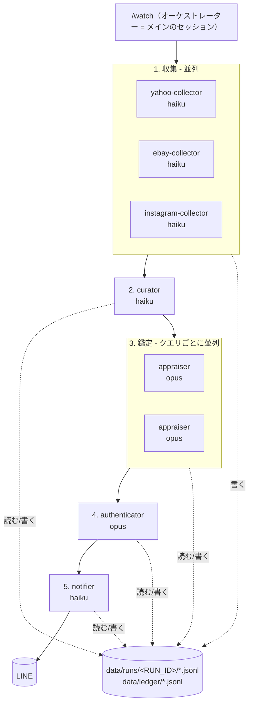

# vintage-watcher

ヴィンテージ古着の新着出品を巡回し、**複数の Claude エージェントが分業して目利きし、本当に欲しいものだけを LINE に通知する**マルチエージェントです。

アプリケーションコードはありません。中身は `.claude/` に置いた **Claude Code のエージェント定義（Markdown）** で、Claude Code が実行エンジンです。

```
/watch
 ├─ 収集   yahoo-collector ┐
 │         ebay-collector  ├ 並列（Haiku）
 │         instagram-collector ┘
 ├─ 選別   curator         既読除外・ルールフィルタ・件数上限・画像DL（Haiku）
 ├─ 鑑定   appraiser × クエリ数   並列（Opus）
 ├─ 検証   authenticator   高得点だけを疑ってかかって再鑑定（Opus）
 └─ 通知   notifier        LINE 送信と台帳への記録（Haiku）
```

---

## 目次

1. [全体アーキテクチャ](#1-全体アーキテクチャ)
2. [使っているマルチエージェントのパターン](#2-使っているマルチエージェントのパターン)
3. [ファイル構成と読み方](#3-ファイル構成と読み方)
4. [権限設計（と検証で分かったこと）](#4-権限設計と検証で分かったこと)
5. [動かしてみる（offline モード）](#5-動かしてみるoffline-モード)
6. [本番のセットアップ](#6-本番のセットアップ)
7. [定期実行とコスト](#7-定期実行とコスト)
8. [メルカリ・ラクマについて](#8-メルカリラクマについて)
9. [学習のための改造課題](#9-学習のための改造課題)

---

## 1. 全体アーキテクチャ



**矢印（実線）はオーケストレーターが渡す「指示と短い報告」だけ**で、出品データそのものは点線のファイル経由で流れます。

### 各エージェントの役割

| エージェント | モデル | ツール | 仕事 |
|---|---|---|---|
| `/watch`（スキル） | 実行時に指定（推奨 sonnet） | Agent, Bash, Read, Write | 工程を分解し、サブエージェントを起動し、報告をまとめる。**自分では出品データを読まない** |
| `yahoo-collector` | haiku | Bash, Read, Write | ヤフオク検索結果 HTML を取得 → `scripts/to-candidates.sh` で正規化 |
| `ebay-collector` | haiku | Bash, Read, Write | eBay Browse API（OAuth）で検索 → 正規化 |
| `instagram-collector` | haiku | Bash, Read, Write | Instagram Graph API でハッシュタグの新着 → 正規化 |
| `curator` | haiku | Bash, Read, Write | 台帳と突き合わせて新着だけに絞る・除外ワード/価格で落とす・件数上限・画像ダウンロード |
| `appraiser` | opus | Read, Write, Glob | 写真と説明文から「欲しいものか」を採点。**ネットワーク・シェル権限なし** |
| `authenticator` | opus | Read, Write, Glob | 高得点だけを反対の立場から見直す（レプリカ・別年代・サイズ違いを疑う） |
| `notifier` | haiku | Bash, Read, Write | LINE に1通のカルーセルで送信し、台帳を書く。**台帳の唯一の書き手** |

---

## 2. 使っているマルチエージェントのパターン

このリポジトリの一番の学習ポイントです。各パターンが「どのファイルのどこに現れているか」も書いています。

### 2.1 オーケストレーター・ワーカー

監督役が仕事を分解して専門のワーカーに配り、結果を統合する基本形です（`.claude/skills/watch/SKILL.md`）。

Claude Code では **サブエージェントは別のサブエージェントを起動できません**。そのため、監督役はサブエージェントではなく
**メインのセッションで動くスキル（`/watch`）** として書いています。監督は1階層だけ、という制約は設計の前提になります。

### 2.2 並列ファンアウト

独立した仕事は「1つのメッセージで複数のサブエージェントを同時に起動」すると並列に走ります。

- 収集: サイトごとに3つ同時
- 鑑定: クエリごとに同時（最大4つ、それ以上は波に分ける）

並列化できるのは**互いの結果に依存しない仕事だけ**です。選別（curator）は全サイトの収集結果が揃わないと始められないので、ここで一度合流します。

### 2.3 コンテキストの分離（ファイル経由の受け渡し）

各サブエージェントは**自分専用のコンテキスト**で動き、最後の報告だけが監督に返ります。
出品データ（数百件の HTML や JSON）を監督の会話に流すと、すぐコンテキストが溢れてコストも膨らむので、
データは `data/runs/<RUN_ID>/` のファイルに置き、監督には「何件・エラー有無」だけを返させています。

そのため、エージェント間の**ファイル形式（データ契約）**が重要になります → `.claude/skills/watch/references/data-contracts.md`。
API 設計のスキーマ定義と同じ役割です。

### 2.4 適材適所のモデル選択

各エージェントの frontmatter の `model:` で、仕事の難しさに合わせてモデルを変えています。

- 機械的な収集・選別・通知 → **haiku**（安くて速い）
- 写真から年代・真贋を見抜く鑑定 → **opus**（ここに予算を集中）

実測では、1回の実行（鑑定4件）のうち haiku 4エージェント分の合計は約 $0.02 で、費用の大半は鑑定とオーケストレーターでした。

### 2.5 評価者パターン（セカンドオピニオン）

`appraiser` が高得点を付けたものだけを、`authenticator` が**反対の立場から**見直します。
同じモデルでも「見つける役」と「疑う役」に分けると、楽観的な判断に引きずられにくくなり、誤報（レプリカの通知など）が減ります。
全件ではなく高得点のものだけを対象にしているので、追加コストは小さく済みます。

### 2.6 決定的な処理は「ツール」にする

初期版では、HTML から出品を抜き出す処理もエージェントに任せていました。検証すると、**同じ入力でも実行ごとに抽出件数が変わり**、
必須フィールドの付け忘れもありました。

そこで変換・既読判定・検証のような「答えが1つに決まる処理」は `scripts/*.sh`（中身は jq）にして、エージェントはそれを**呼ぶだけ**にしました。

| LLM に任せる | ツールにする |
|---|---|
| どのキーワードで何を取るか、エラー時にどう切り分けるか、除外ワードの判断、鑑定、通知文 | HTML/JSON → 共通形式への変換、台帳との突き合わせ、データ契約の検証 |

「全部エージェント」でも、**エージェントが判断し、ツールが実行する**という分担は残ります。MCP やツール呼び出しと同じ考え方です。

### 2.7 最小権限と単一の書き手

- **信頼できないテキストを一番深く読むエージェントほど権限を小さく**: 出品の説明文には第三者が何でも書けます（プロンプトインジェクション）。
  説明文を精読する `appraiser` / `authenticator` には Read / Write しか与えず、外部に何かを送る手段を持たせていません
- **台帳に書くのは notifier だけ**: 複数のエージェントが同じファイルに書くと壊れやすいので、書き手を1人にしています。
  台帳は「1回の実行で1ファイル」の追記専用で、過去のファイルは書き換えません
- **失敗したら記録しない**: 鑑定できなかったもの・件数上限で後回しにしたもの・LINE 送信に失敗したものは台帳に書かず、次回の実行で自然に再挑戦されます

---

## 3. ファイル構成と読み方

```
.claude/
├── skills/watch/
│   ├── SKILL.md                  # オーケストレーター（/watch）★最初に読む
│   └── references/
│       └── data-contracts.md     # エージェント間のファイル形式
└── agents/                       # サブエージェント定義
    ├── yahoo-collector.md
    ├── ebay-collector.md
    ├── instagram-collector.md
    ├── curator.md
    ├── appraiser.md              # ★目利きのプロンプト
    ├── authenticator.md
    └── notifier.md
CLAUDE.md                         # 全エージェント共通の前提（秘密情報・信頼できない入力の扱い）
ci/claude-settings.json           # 権限の許可リスト（ヘッドレス実行で使う）
scripts/                          # エージェントが呼ぶ決定的なツール（jq）
fixtures/                         # offline モード用のサンプルデータ
watchlist.example.yaml            # 欲しいもの定義
.github/workflows/watch.yml       # 定期実行
```

### サブエージェント定義の書き方

```markdown
---
name: appraiser                      # 呼び出し名
description: ヴィンテージ古着の目利き担当。...   # いつ使うかの説明。監督はこれを見て使い分ける
tools: Read, Write, Glob             # 使えるツール（省略すると全部）。最小権限の要
model: opus                          # haiku / sonnet / opus / inherit
---

（ここから下がこのエージェントのシステムプロンプト）
```

サブエージェントは**監督との会話を見られません**。だから各定義は「入力として何が渡されるか」「どこに何を書くか」「何を報告するか」まで自己完結させています。

### データの流れ（1回の実行）

```
data/runs/20261103T103403Z/
├── raw/                          collector が取得した生データ
├── candidates-ebay.jsonl         collector → curator
├── new.jsonl                     curator: 台帳に無い新着
├── triage.jsonl                  curator: 全新着の振り分け（appraise / filtered / deferred）
├── to_appraise-<query>.jsonl     curator → appraiser
├── appraisals-<query>.jsonl      appraiser → authenticator / notifier
├── verdicts.jsonl                authenticator → notifier
├── line_payload.json             notifier が送った内容
└── summary.md                    オーケストレーターのまとめ
data/ledger/20261103T103403Z.jsonl   notifier が書く台帳（次回以降の既読判定に使う）
```

実行後にこれらのファイルを開くと、**各エージェントが何を受け取り何を判断したか**を追跡できます。マルチエージェントのデバッグはここが基本です。

---

## 4. 権限設計（と検証で分かったこと）

無人で動かす（`claude -p`）ときは、`--permission-mode dontAsk` で**許可リストにない操作をすべて自動拒否**しています。
許可リストは `ci/claude-settings.json` にあります。

```json
"allow": ["Agent", "Read", "Glob", "Grep",
          "Write(./data/**)", "Edit(./data/**)",          // 書き込みは data/ 配下だけ
          "Bash(scripts/*.sh *)", "Bash(curl *)", "Bash(jq *)", ...],
"deny":  ["Read(./.env)", "Bash(env *)", "Bash(rm *)", "Bash(git *)", ...]
```

> `.claude/settings.json` に置けば対話実行でも自動で読まれますが、作業中のセッションの権限設定を書き換えることになるため、
> 今回はエージェント（私）からは作成していません。対話でも同じ権限で使いたい場合は、ご自身で
> `cp ci/claude-settings.json .claude/settings.json` してください。

実際に `claude -p` で動かして分かった「許可ルールに通らない書き方」と、その対策です。各エージェントの定義に「Bash の書き方」として明記しています。

| 拒否されたもの | 対策 |
|---|---|
| `a && b`、`R=...`（変数代入）、`$(...)`、`> file` | 1回の呼び出しで1コマンド。ファイル出力は `curl -o` / `\| tee data/...` / Write ツール |
| jq の `--arg` と `$変数` | 値はリテラルで埋め込む。環境変数は jq の `env.NAME` で読む |
| `jq -f script.jq`（明示的に許可しても不可） | 実行可能なラッパー `scripts/*.sh` にして `Bash(scripts/*.sh *)` で許可 |
| `.claude/` 配下のファイルを Bash から参照 | スクリプトは `scripts/` に置く |
| 絶対パス（`/home/.../data/...`） | 相対パスで書く（`tee data/*` のルールに一致させる） |

**最初の試験実行では Bash がほぼ全部拒否されていました。** それでもエージェントは Read / Write で回避して最後まで完走しましたが、その結果は不安定でした。
「エージェントは止まらずに回避策を取る」ので、**拒否ログ（`permission_denials`）を見ないと問題に気づけません**。これも大事な学びです。

---

## 5. 動かしてみる（offline モード）

API キーなしで（Claude の認証だけで）、サンプルデータを使って全工程を体験できます。

```bash
npm install -g @anthropic-ai/claude-code   # Claude Code（未導入なら）

# サンプルデータで全工程を実行（LINE 送信・台帳書き込みなし）
claude -p "/watch offline dry-run" \
  --settings ci/claude-settings.json --permission-mode dontAsk --max-budget-usd 2

# 結果を見る
cat data/runs/*/summary.md
ls data/runs/*/
```

対話モードで `claude --settings ci/claude-settings.json` を起動して `/watch offline dry-run` と打てば、
サブエージェントが並列に起動していく様子をリアルタイムで見られます。

| 引数 | 動作 |
|---|---|
| （なし） | 本番。取得 → 選別 → 鑑定 → 真贋チェック → LINE 通知 → 台帳 |
| `baseline` | 今ある出品を全部「既読」にするだけ（初回に1回。これをしないと初回に大量通知される） |
| `dry-run` | LINE に送らず、台帳も書かない |
| `offline` | 出品データを `fixtures/` のサンプルで代用（収集と画像だけに影響）。`offline` 単体なら LINE 送信も行うので疎通確認に使える |

> `fixtures/yahoo_auctions/search.html` はリンクの無い広告カードを1枚含むので、yahoo-collector が「カード3 / 抽出2」と報告するのは正常です。
> また offline ではヤフオクのサンプルを全クエリで共用するため、チャンピオンのクエリにリーバイスが混ざります（appraiser が低得点を付けます）。

### この環境で確認したこと

`claude -p` で実際に以下を実行し、許可されなかった操作（権限拒否）が0件であることを確認しました。

- `offline dry-run`: 収集 8件 → 新着 8 → 除外 4 → 鑑定 4（2並列） → 真贋チェック → 通知対象 1件
- `offline`（LINE 未設定）: 送信失敗を報告し、通知予定の出品は台帳に書かれない（次回再通知される）
- 2回目の実行: 台帳と突き合わせて新着 0件になり、鑑定が走らない

**実サイト（ヤフオク・eBay・Instagram）と LINE への接続は、この環境のネットワーク制限のため未検証です。**
特にヤフオクの HTML 構造は `scripts/yahoo-to-candidates.jq` の前提と違う可能性があります。その場合は yahoo-collector が件数の検算で異常を報告するので、スクリプトを調整してください。

---

## 6. 本番のセットアップ

1. `cp watchlist.example.yaml watchlist.yaml` して欲しいものを書く。**`description` を具体的に書くほど鑑定精度が上がります**
   （「ヴィンテージの501」より「赤タブがスモールe、トップボタン裏刻印6、バックポケット裏シングルステッチ」）
2. `cp .env.example .env` して各キーを書き、`set -a; source .env; set +a` でシェルに読み込む
   （エージェントは `.env` を直接読めないよう権限で拒否しています）
3. `claude -p "/watch offline" ...` で LINE にテスト通知が届くか確認
4. `claude -p "/watch baseline" ...` で既存の出品を既読化
5. 以降は `claude -p "/watch" ...` を定期実行

### Claude Code の認証

- API キー課金: `ANTHROPIC_API_KEY`
- Claude のサブスクリプション: `claude setup-token` で発行したトークンを `CLAUDE_CODE_OAUTH_TOKEN` に

### LINE（必須）

LINE Notify は 2025年3月に終了したため、**LINE Messaging API**（自分専用 Bot からのプッシュ）を使います。

1. [LINE Official Account Manager](https://manager.line.biz/) で公式アカウントを作成（無料プランで可）→ 設定 → Messaging API を有効化
2. [LINE Developers コンソール](https://developers.line.biz/console/) でチャネルを開く
   - Messaging API設定 → チャネルアクセストークン（長期）→ `LINE_CHANNEL_ACCESS_TOKEN`
   - チャネル基本設定 → あなたのユーザーID（`U...`）→ `LINE_TO_USER_ID`
3. Messaging API設定の QR コードで Bot を友だち追加

無料プランは月200通。「通数」は送信回数で数え、1通に何枚カードを入れても1通なので、notifier は見つかったものを1通のカルーセルにまとめます。

### eBay（任意）

[developer.ebay.com](https://developer.ebay.com) で Production のキーセットを作成し、App ID → `EBAY_CLIENT_ID`、Cert ID → `EBAY_CLIENT_SECRET`。

### Instagram（任意）

公式 Graph API のハッシュタグ検索を使います。Instagram をプロアカウントにし、Facebook ページと連携、
Meta for Developers でアプリを作成して長期アクセストークン（`IG_ACCESS_TOKEN`）と IG ユーザーID（`IG_USER_ID`）を取得します。
ハッシュタグは7日間で30種類まで、取得できるのは直近24時間の投稿のみです。

---

## 7. 定期実行とコスト

### GitHub Actions

`.github/workflows/watch.yml` が3時間ごとに `claude -p "/watch"` を実行します。

1. `watchlist.yaml` をコミット（プライベートリポジトリ推奨）
2. Settings → Secrets and variables → Actions に各キーを登録
3. Actions タブで `watch` を手動実行（引数に `offline dry-run` などを指定可）

台帳は `actions/cache` で引き継ぎ、初回は自動で `baseline` になります。各回の `summary.md` と全エージェントの JSONL は artifact として14日間残るので、後から判断の過程を追えます。

### コスト（offline での実測値）

| 実行内容 | 費用 |
|---|---|
| 新着なし（収集 + 選別 + 通知のみ） | 約 $0.24〜0.32 |
| baseline | 約 $0.27〜0.30 |
| 鑑定4件 + 真贋チェック | 約 $0.50〜0.67 |

内訳（オーケストレーター sonnet、鑑定4件）: オーケストレーター約 $0.24 / appraiser・authenticator（opus）約 $0.25 / haiku 4エージェント合計 約 $0.02。

**新着が無い回でも固定費がかかる**のが、Python で書く方式との大きな違いです。1時間ごとに回すと月 $150〜200 程度になりうるため、ワークフローは3時間ごと（月 $60 前後 + 鑑定費）にしています。
`--max-budget-usd 3` が1回あたりの上限、`settings.judge.max_appraisals_per_run` が鑑定件数の上限です。
サブスクリプション（`CLAUDE_CODE_OAUTH_TOKEN`）で動かす場合は、金額ではなく利用枠を消費します。

固定費を下げる工夫は [9. 学習のための改造課題](#9-学習のための改造課題) を参照してください。

---

## 8. メルカリ・ラクマについて

**メルカリ・ラクマ（・Yahoo!フリマ）の自動取得は実装していません。**
公開 API がなく、利用規約で許可のない自動アクセスが禁止されているためです（アカウント停止のリスクもあります）。

代わりに **公式アプリの「検索条件を保存」→ 新着通知** を併用してください。将来公式 API が出たら、collector を1つ足すだけで対応できます。

---

## 9. 学習のための改造課題

マルチエージェントの理解を深めるための題材です。

1. **新しい collector を足す**: 古着屋さんの EC（Shopify の `/products.json` など）用に `.claude/agents/shop-collector.md` と変換スクリプトを書き、SKILL.md の表に1行追加する。データ契約さえ守れば他のエージェントは無修正で動くことを確かめる
2. **オーケストレーターを安くする**: 監督を haiku にした場合、指示の質や並列起動の判断がどう変わるかを `summary.md` と JSONL ログで比較する
3. **hooks で決定的なガードを入れる**: `SubagentStop` フックで「collector が書いた JSONL を `scripts/check-candidates.sh` で自動検証し、違反があれば差し戻す」。プロンプトでのお願いと、仕組みでの強制の違いを体験できる
4. **鑑定の並列度を変える**: クエリ単位ではなく「出品1件 = 1 appraiser」にすると、精度・コスト・速度がどう変わるか
5. **フィードバックループ**: LINE の返信（「いいね」「違う」）を記録し、appraiser のプロンプトに過去の判断例（few-shot）として渡す
6. **相場エージェント**: 過去の台帳から同じクエリの価格分布を出す `market-analyst` を追加し、authenticator に「相場から外れていないか」の材料を渡す
